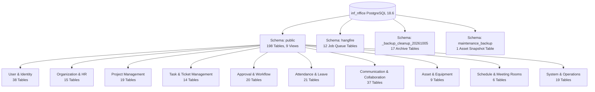

# 01 – Database Overview & Environment Report
## Groupware AI Chatbot Project – Phase 1: Database Discovery

> [!NOTE]
> This document provides the high-level technical overview, environment specification, restoration metrics, and structural summary of the discovered Groupware database.

---

## 1. Executive Summary

| Property | Value |
|---|---|
| **Project** | Groupware AI Chatbot (Phase 1: Database Discovery) |
| **Source Database Name** | `inf_nffice` |
| **Database Engine** | PostgreSQL |
| **Database Version** | `PostgreSQL 18.6 on x86_64-windows, compiled by msvc-19.44.35229, 64-bit` |
| **Source Dump File** | `database/inf_nffice_latest.dump.gz` (Preserved original) |
| **Dump Uncompressed Size** | `88,885,890 bytes` (~84.77 MB) |
| **Dump Compressed Size** | `87,271,713 bytes` (~83.23 MB) |
| **Dump Format** | PostgreSQL Custom Archive (`pg_dump -Fc`, Version 1.16-0) |
| **Dump Timestamp** | `2026-11-03 19:00:11 UTC` |
| **Restoration Environment** | Isolated Local PostgreSQL 18.6 Cluster (Port 5433) |
| **Restoration Status** | **SUCCESSFUL (100% Clean, 0 SQL Errors)** |
| **Total Schemas** | `5` |
| **Total Base Tables** | `228` |
| **Total Views** | `9` |
| **Total Indexes** | `814` |
| **Total Stored Routines** | `84` |
| **Total Triggers** | `16` |
| **Total Sequences** | `186` |
| **Total Business Records** | `1,480,332` rows across all tables |

---

## 2. Environment & Restoration Details

### 2.1 Isolated Local Database Setup
To strictly adhere to security guidelines (no external data transmission, read-only analysis, isolated development environment), a standalone PostgreSQL 18.6 cluster was provisioned on local port `5433`:
- **Cluster Data Directory**: `C:\Project\chatbot\.pgdata`
- **Configuration**: Local trust authentication for loopback interface `127.0.0.1/32`
- **Target Database**: `inf_nffice` (Owner: `inf_vn_db`)
- **Restoration Tool**: `pg_restore (PostgreSQL) 18.6`
- **Execution Script**: [`scripts/database-discovery/restore_database.py`](file:///C:/Project/chatbot/scripts/database-discovery/restore_database.py)
- **Restoration Log**: [`artifacts/database-discovery/restoration.log`](file:///C:/Project/chatbot/artifacts/database-discovery/restoration.log)

### 2.2 Restoration Verification Metrics
- **Duration**: `43.12 seconds`
- **Items Restored**: `2,177 TOC items`
- **SQL Execution Errors**: `0`
- **Warnings**: `0`
- **Extensions Enabled**:
  1. `pg_trgm` (Trigram matching for text search)
  2. `pgcrypto` (Cryptographic hashing functions)
  3. `unaccent` (Accent-insensitive search)

---

## 3. Discovered Database Schemas

The database contains 5 distinct schemas:

| Schema Name | Owner | Description |
|---|---|---|
| `_backup_cleanup_20261005` | `postgres` | N/A |
| `hangfire` | `postgres` | N/A |
| `maintenance_backup` | `postgres` | N/A |
| `pg_toast` | `postgres` | reserved schema for TOAST tables |
| `public` | `pg_database_owner` | standard public schema |

### Schema Role Breakdown:
1. **`public`**: The core operational schema containing **207 relations** (198 base tables + 9 business views). All Groupware domain operations reside here.
2. **`hangfire`**: Contains **12 tables** utilized by the Hangfire background job scheduler (e.g. `hangfire.job`, `hangfire.state`, `hangfire.counter`).
3. **`_backup_cleanup_20261005`**: Contains **17 tables** holding archived backup snapshots created during a maintenance cleanup on October 5, 2026 (e.g. `users_deleted`, `user_profiles_deleted`).
4. **`maintenance_backup`**: Contains **1 table** (`asset_reset_snapshots`) preserving state prior to an asset reset routine.
5. **`pg_toast`**: PostgreSQL internal storage mechanism for oversized attribute storage.

---

## 4. Overall Structural Architecture

### Key Architectural Discovery:
- **Application-Enforced Referential Integrity**: The database defines only **2 explicit foreign key constraints** (both located inside the `hangfire` system schema). The `public` business schema contains **zero explicit foreign keys**. All referential integrity is enforced at the application/ORM tier.
- **276 Inferred Relationships**: Using automated foreign-key discovery and data match profiling, **276 business relationships** and **31 junction/mapping tables** were identified and validated.
