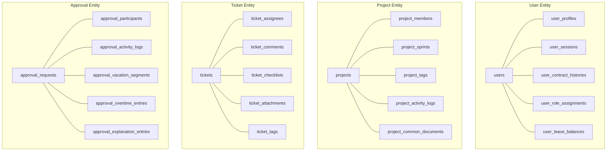

# 05 – Business Entity Catalog (SUPERSEDED)
## Groupware AI Chatbot Project – Phase 1: Database Discovery

> [!WARNING]
> **SUPERSEDED – DO NOT USE AS CANONICAL**:
> This document represents the initial, unrefined Business Entity Catalog and has been formally superseded by `05_business_entity_master_catalog.md`, `11_business_entity_master_catalog.md`, and `21_phase1_1_final_graph_data_model.md`.
> **Canonical Master Catalog**: Please consult [`05_business_entity_master_catalog.md`](file:///C:/Project/chatbot/documentation/phase-1-database-discovery/05_business_entity_master_catalog.md) and [`21_phase1_1_final_graph_data_model.md`](file:///C:/Project/chatbot/documentation/phase-1-database-discovery/21_phase1_1_final_graph_data_model.md) for authoritative entity definitions, verified source columns, and accurate relationship models.

---

## 1. Core Discovered Business Entities (Historical Draft)

| Entity Name | Business Meaning | Source Tables | Primary Identifier | Important Attributes | Related Entities | Relationship Type | Business Rules & Logic | Confidence |
|---|---|---|---|---|---|---|---|---|
| **User** | System employee, account, and personal profile | `users`, `user_profiles`, `user_sessions`, `user_contract_histories` | `users.id` (bigint) | `username`, `email`, `display_name`, `employee_number`, `grade`, `position`, `joining_date`, `is_active`, `is_resigned` | Department, Role, Project, Ticket, ApprovalRequest | Many-to-One (Department), Many-to-Many (Roles, Projects, Tickets) | 1-to-1 extension in `user_profiles`. Active flag and resigned date determine current employment status. | **Confirmed** |
| **Department** | Organizational department, unit, or division | `departments`, `department_members` | `departments.id` (bigint) | `code`, `name`, `parent_id`, `depth`, `path`, `manager_user_id`, `department_type`, `is_active` | Department (Parent), User (Manager), User (Members) | Self-ref (Hierarchy), One-to-Many (Members) | Tree hierarchy maintained via `parent_id` and materialized `path`. Managed by `manager_user_id`. | **Confirmed** |
| **Project** | Business initiative, workspace, or software project | `projects`, `project_members`, `project_sprints`, `project_tags` | `projects.id` (bigint) | `name`, `key`, `description`, `status`, `approval_status`, `service_type`, `start_date`, `end_date` | User (Owner/Members), Ticket, Sprint | One-to-Many (Members, Sprints, Tickets) | Projects have distinct roles (`owner`, `admin`, `member`) in `project_members`. Status lifecycle: `new` -> `in_progress`. | **Confirmed** |
| **Task / Ticket** | Discrete task, issue, bug, or action item | `tickets`, `ticket_assignees`, `ticket_comments`, `ticket_checklists`, `ticket_attachments` | `tickets.id` (bigint) | `code`, `title`, `description`, `priority`, `due_date`, `start_date`, `completed_at`, `estimated_hours`, `actual_hours`, `column_id` | Project, Sprint, User (Assignees, Creator), KanbanColumn | Many-to-One (Project, KanbanColumn), Many-to-Many (Assignees) | Assigned to multiple users via `ticket_assignees`. Progress tracked via Kanban column position. Support subtasks via `parent_ticket_id`. | **Confirmed** |
| **Approval Request** | Formal electronic workflow document (leave, overtime, expense) | `approval_requests`, `approval_participants`, `approval_activity_logs`, `approval_vacation_request_segments`, `approval_overtime_entries`, `approval_explanation_entries`, `approval_comments` | `approval_requests.id` (bigint) | `document_no`, `title`, `request_type`, `status`, `leave_type`, `created_by_user_id`, `submitted_at`, `completed_at` | User (Requester), User (Approvers/Participants), ApprovalWorkflowTemplate | Many-to-One (Requester), One-to-Many (Participants, Segments, Logs) | Multi-stage signoff lifecycle: `SUBMITTED` -> `IN_PROGRESS` -> `COMPLETED` / `REJECTED` / `CANCELLED`. Supports vacation segments, overtime, expenses. | **Confirmed** |
| **Attendance Record** | Daily employee work attendance and biometric timestamps | `attendance_daily_records`, `attendance_ingest_events`, `attendance_face_events`, `attendance_logs` | `attendance_daily_records.id` (bigint) | `user_id`, `work_date`, `check_in_time`, `check_out_time`, `working_minutes`, `overtime_minutes`, `status` | User | Many-to-One (User) | Raw clock events ingested into `attendance_ingest_events` and calculated daily into `attendance_daily_records`. | **Confirmed** |
| **Leave Balance** | Annual and monthly employee leave balance and accruals | `user_leave_monthly_balances`, `user_leave_year_balances`, `user_leave_month_end_snapshots` | `user_leave_monthly_balances.id` (bigint) | `user_id`, `year`, `month`, `total_days`, `used_days`, `remaining_days` | User, LeaveCatalog | Many-to-One (User) | Tracks remaining paid vacation days. Decremented upon completed vacation approval requests. | **Confirmed** |
| **Schedule Event** | Calendar appointment, meeting, or company event | `schedule_events`, `schedule_event_participants`, `schedule_rooms`, `schedule_categories` | `schedule_events.id` (bigint) | `title`, `start_time`, `end_time`, `is_all_day`, `visibility`, `recurrence_type`, `room_id`, `user_id` | User (Organizer, Attendees), ScheduleRoom | Many-to-One (Organizer, Room), Many-to-Many (Attendees) | Scheduled with meeting room bookings (`schedule_rooms`) and attendee invitations in `schedule_event_participants`. | **Confirmed** |
| **Chat Conversation** | Direct or group instant messaging channel | `chat_conversations`, `chat_conversation_members`, `chat_messages`, `chat_message_attachments` | `chat_conversations.id` (bigint) | `title`, `type`, `creator_id`, `created_at`, `updated_at`, `last_message_at` | User (Creator, Members), ChatMessage | One-to-Many (Messages), Many-to-Many (Members) | Direct 1:1 or multi-user group chat channels. Real-time message history stored in `chat_messages`. | **Confirmed** |
| **Notice / Announcement** | Official company broadcast notice | `notices`, `notice_attachments`, `notice_reads`, `notice_comments` | `notices.id` (bigint) | `title`, `content`, `author_id`, `is_pinned`, `view_count`, `published_at`, `is_active` | User (Author, Readers) | Many-to-One (Author), Many-to-Many (Readers) | Broadcast notices with read receipt auditing via `notice_reads`. | **Confirmed** |
| **Community Post (Talk)** | Social / internal community discussion post | `talk_posts`, `talk_post_comments`, `talk_post_attachments`, `talk_post_reactions` | `talk_posts.id` (bigint) | `title`, `content`, `author_id`, `category_id`, `likes_count`, `comments_count` | User (Author, Commenters) | Many-to-One (Author), One-to-Many (Comments, Reactions) | Internal social networking and discussion board with likes and threaded comments. | **Confirmed** |
| **Company Asset** | Physical office asset, laptop, monitor, or equipment | `assets`, `asset_assignments`, `asset_categories` | `assets.id` (bigint) | `code`, `name`, `serial_number`, `status`, `acquisition_type`, `category_id`, `current_holder_id` | User (Holder), AssetCategory | Many-to-One (Category), Many-to-Many / One-to-Many (Assignments) | Assigned to employees with lifecycle tracking: `ACTIVE` -> `IN_USE` -> `MAINTENANCE` -> `DISPOSED`. | **Confirmed** |
| **Role & Permission** | System authorization and access control rules | `roles`, `permissions`, `role_permissions`, `user_role_assignments`, `user_permissions` | `roles.id` (bigint), `permissions.id` (bigint) | `name`, `code`, `description`, `is_system` | User, Role, Permission | Many-to-Many (User to Role, Role to Permission) | RBAC model where users inherit permissions through assigned roles, with optional direct overrides in `user_permissions`. | **Confirmed** |

---

## 2. Multi-Table Entity Syntheses

In the physical database, several core business entities are partitioned across multiple satellite tables:

