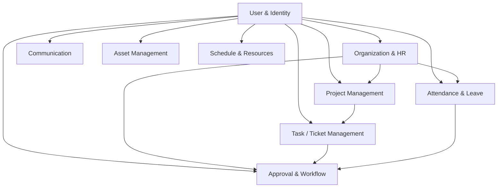

# 06 – Business Module Classification
## Groupware AI Chatbot Project – Phase 1: Database Discovery

> [!NOTE]
> This document classifies all discovered database tables into unified functional business modules, establishes their relative data importance, and maps critical cross-module relationships essential for Graph modeling.

---

## 1. Business Module Classification Table

| Module Name | Table Count | Main Business Entities | Description & Scope | Data Importance | Total Records |
|---|---|---|---|---|---|
| **User & Identity Management** | 38 | `User`, `UserProfile`, `Role`, `Permission`, `Menu`, `BotAccount` | Authentication, user profiles, RBAC authorization, session history, and bot account mapping. | **CRITICAL** | 32,399 |
| **Organization Management** | 15 | `Department`, `DepartmentMember`, `JobTitle`, `JobGrade`, `Audience` | Company hierarchy, department tree, position assignments, target audiences, and organizational changes. | **CRITICAL** | 872 |
| **Project Management** | 19 | `Project`, `ProjectMember`, `Sprint`, `ProjectTag`, `ActivityLog` | Workspaces, sprint planning, project staffing, activity auditing, and common documents. | **HIGH** | 5,595 |
| **Task / Ticket Management** | 14 | `Ticket`, `TicketAssignee`, `KanbanColumn`, `TicketComment`, `Checklist` | Work item tracking, kanban workflows, subtask hierarchies, and time estimation. | **CRITICAL** | 2,752 |
| **Approval & Workflow Management** | 20 | `ApprovalRequest`, `ApprovalParticipant`, `WorkflowStep`, `Regulation`, `Rule` | Multi-stage approvals for leave, overtime, expenses, procurement, and business regulations. | **HIGH** | 48,926 |
| **Attendance & Leave Management** | 21 | `AttendanceRecord`, `AttendanceEvent`, `LeaveBalance`, `Holiday`, `WorkCalendar` | Biometric clock-in/out logs, daily calculated attendance, paid leave accruals, and work calendars. | **HIGH** | 377,095 |
| **Communication & Collaboration** | 37 | `ChatConversation`, `ChatMessage`, `Notice`, `TalkPost`, `Notification` | Real-time chat, company notices, community social feed (Talk), email logs, and push notifications. | **MEDIUM** | 73,056 |
| **Asset & Equipment Management** | 9 | `Asset`, `AssetAssignment`, `AssetCategory` | Company hardware, laptops, monitors, allocation history, and maintenance lifecycle. | **MEDIUM** | 1,862 |
| **Schedule & Resource Management** | 6 | `ScheduleEvent`, `EventParticipant`, `ScheduleRoom`, `WorkType` | Calendar appointments, meeting room reservations, work schedules, and attendee management. | **MEDIUM** | 1,632 |
| **System & Operational Infrastructure** | 19 | `SystemLog`, `File`, `ErrorTracking`, `Alert`, `License` | System request logs, file storage metadata, error tracking outbox, and license state. | **LOW (Operational)** | 934,552 |
| **Hangfire Job Engine (Schema `hangfire`)** | 12 | `Job`, `JobParameter`, `State`, `Counter` | Asynchronous background processing queue and worker execution state. | **LOW (Infrastructure)** | 14,210 |
| **Maintenance Archives (Schemas `_backup_*`)** | 18 | `UsersDeleted`, `ProfilesDeleted`, `AssetResetSnapshots` | Archived historical backups generated during maintenance routines. | **REFERENCE ONLY** | 8,920 |

---

## 2. Module Dependency Graph



---

## 3. High-Value Cross-Module Traversal Paths for AI Chatbot Graph Queries

These traversal paths bridge multiple modules and represent the highest-value analytical queries for the future Neo4j Knowledge Graph:

### Path A: Staffing, Project, and Task Accountability
```
(User:Employee) -[:BELONGS_TO]-> (Department:Dept)
      |
   [:MEMBER_OF {role: 'owner'|'leader'}]
      v
(Project:Proj) <-[:PART_OF]- (Ticket:Task {priority: 'urgent', status: 'create'})
      ^                                |
      |-- [:ASSIGNED_TO] --------------|
```
*Allows answering: "Which employees in the Engineering department are assigned to urgent tasks on projects owned by John Doe?"*

### Path B: Attendance, Leave, and Approval Correlation
```
(User:Employee) -[:REQUESTED]-> (ApprovalRequest:Req {type: 'vacation', status: 'COMPLETED'})
      |                                |
      |                           [:COVERS_PERIOD]
      v                                v
(AttendanceDailyRecord {status: 'ABSENT'})
```
*Allows answering: "Was employee Jane Doe on approved annual leave yesterday, or was her absence unexcused?"*

### Path C: Department Leadership and Resource Allocation
```
(Department:Dept) <-[:LEADS]- (User:Manager)
      ^
   [:ALLOCATED_TO]
      |
(Asset:Laptop {status: 'IN_USE'}) -[:ASSIGNED_TO]-> (User:Staff)
```
*Allows answering: "List all laptops currently in use by members of the department managed by Sarah."*
