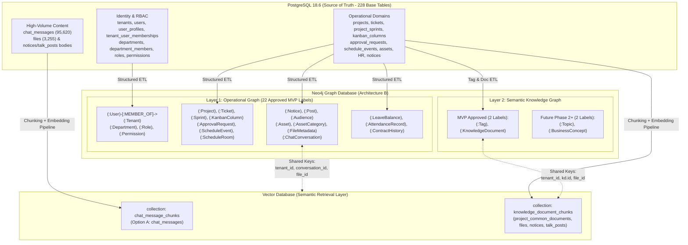

# PHASE 1.2 / 1.2.1 / 1.2.2 – FINAL GRAPH ARCHITECTURE SPECIFICATION (WORK PACKAGE 4)
## Groupware AI Chatbot – PostgreSQL + Neo4j + Vector Database

**Document ID:** `32_phase1_2_final_graph_architecture.md`  
**Phase:** Phase 1.2 / Phase 1.2.1 / Phase 1.2.2 – ETL Lifecycle, Tenant Security & Runtime Evidence Hardening  
**Date:** 2026-11-05  
**Status:** Canonical Architecture Specification (Supersedes `21_phase1_1_final_graph_data_model.md`)  
**Evidence Level:** `STATICALLY VALIDATED` (Verified against `artifacts/database-discovery/schema_inventory.json`, `artifacts/phase1_2/data_profile.json`, `29_phase1_2_final_user_tenant_model.md`, `30_phase1_2_complete_node_mapping.md`, and `31_phase1_2_complete_relationship_mapping.md`)

---

## 1. Executive Summary & Preserved Architectural Decisions

This specification defines the single canonical graph architecture for the Groupware AI Chatbot project, reconciling all remaining contradictions between the Phase 1 (`13_neo4j_graph_architecture_design.md`) and Phase 1.1 (`21_phase1_1_final_graph_data_model.md`) graph models, and incorporating all Phase 1.2.1 (`DEFECT 01`–`DEFECT 09`) and Phase 1.2.2 (`CRITICAL-01`–`CRITICAL-06` / `HIGH-05`) corrections.

### 1.1 Preserved Core Decisions

1. **Architecture B – Operational Graph + Semantic Knowledge Graph**:
   - **PostgreSQL (`PostgreSQL 18.6`)** is the authoritative system of record for transactional data, RBAC tables, and the `public.check_user_permission(...)` routine.
   - **Neo4j** stores the derived **Operational Graph** (`22` approved MVP operational node labels) and **Semantic Knowledge Graph** (`2` approved MVP semantic node labels `:Tag` and `:KnowledgeDocument`, plus `2` future semantic node labels `:Topic` and `:BusinessConcept`).
   - **Vector Database** stores dense and sparse vector embeddings, chunked document text, chat message streams, notice/post long-form text bodies, and OCR/parsed file chunks.
   - **Backend Orchestrator** enforces authentication, active tenant resolution (`tenant_user_memberships`), RBAC authorization, and sensitivity redaction independently of the LLM and Neo4j.
2. **ChatMessage Option A (Strict Preservation)**:
   - **No `:ChatMessage` nodes** and **no `:KnowledgeChunk` nodes** are created in Neo4j (`public.chat_messages` has `95,620` rows and grows continuously).
   - Neo4j models only `:ChatConversation` (`NM-19`, `329` rows) and participation edges (`[:CREATED_BY]` `RM-35`, `[:MEMBER_OF_CONVERSATION]` `RM-34`).
   - Full chat message text, embeddings, and chunk windows reside exclusively in the Vector Database / PostgreSQL.
3. **Global User + N:M Tenant Membership (`(:User)-[:MEMBER_OF]->(:Tenant)`)**:
   - `:User` (`NM-02`) represents a global account (`public.users` has no `tenant_id`).
   - Tenant membership and tenant-scoped profile attributes (`user_profiles` has `ux_user_profiles_tenant_user (tenant_id, user_id)`) reside on `(:User)-[m:MEMBER_OF]->(:Tenant)` (`RM-01`).
4. **Dual-Scope `:Audience` Ownership (`NM-20` — DEFECT 04 & CRITICAL-04 Resolution)**:
   - System audiences (`is_system = true`, `1` row: `id = 1`, `audience_type = 'ALL'`) are Global System Template nodes (`a.tenant_id IS NULL`) with zero explicit member edges; custom audiences (`is_system = false`, `115` rows) are Tenant-Scoped nodes (`a.tenant_id IS NOT NULL`).
5. **6-Step Deterministic `:AttendanceRecord` Active-Membership Resolution (`NM-22` & `RM-37` — DEFECT 02 & CRITICAL-01 Resolution)**:
   - Only rows classified as `RESOLVED_BY_USER_ID` or unambiguous `RESOLVED_BY_EMPLOYEE_NUMBER` where `tenant_user_memberships` has **`m.status = 'active' AND m.is_deleted = false`** (`Rule MEM-ACTIVE`) are loaded into `:AttendanceRecord` (`NM-22`) and linked via `[:HAS_ATTENDANCE]` (`RM-37`); `UNRESOLVED`, `AMBIGUOUS`, `INVALID_TENANT`, and `INVALID_SOURCE_REFERENCE` rows are quarantined (`0` unlinked `:AttendanceRecord` nodes in Neo4j).
6. **Unambiguous `:LeaveBalance` Tenant Derivation (`NM-21` & `RM-36` — CRITICAL-02 Resolution)**:
   - `:LeaveBalance` (`NM-21`) aggregates `public.user_leave_year_balances` + `public.user_leave_monthly_balances` and derives `tenant_id` via `user_unambiguous_leave_tenant` (`tenant_user_memberships` + `user_profiles`, `COUNT(DISTINCT tenant_id) = 1`), preserving single-tenant historical balances while quarantining multi-tenant ambiguity (`SD-07`).
7. **Per-Node Reconciliation Identity Contract (`CRITICAL-06` Resolution)**:
   - Every approved MVP node defines an explicit Graph Identity Key (`id` for `NM-01`–`NM-10`, `NM-12`–`NM-23`, `NM-25`; synthetic `tag_key` for `NM-24` `:Tag`) and a per-node reconciliation rule in `Doc 33` Section 2.6.

---

## 2. Reconciled Architecture Overview

---

## 3. Layer 1 & Layer 2 Canonical Node Catalog (27 Evaluated Node Labels)

Every node label below is 100% aligned with `30_phase1_2_complete_node_mapping.md` (`NM-01`–`NM-25`, `ND-11`, `ND-26`, `ND-27`). Note that every approved MVP node also carries the ETL audit property `last_synced_at` (`DateTime`).

| Node ID | Canonical Label | Graph Layer | Source Table (`public.*`) | Rows | Key Properties (Exact Physical Mapping + `last_synced_at`) | MVP Status |
|---|---|---|---|---:|---|---|
| `NM-01` | `:Tenant` | Operational | `public.tenants` | 1 | `id`, `tenant_key`, `name`, `status`, `isolation_mode`, `is_default`, `is_deleted`, `created_at`, `updated_at`, `last_synced_at` | **`MVP – APPROVED`** |
| `NM-02` | `:User` | Operational | `public.users` + `LEFT JOIN user_profiles` | 360 | `id`, `username`, `email`, `display_name`, `is_active`, `is_deleted`, `created_at`, `updated_at`, `last_synced_at` (NO `tenant_id`) | **`MVP – APPROVED`** |
| `NM-03` | `:Department` | Operational | `public.departments` | 103 | `id`, `tenant_id`, `code`, `name`, `depth`, `path`, `department_type`, `is_active`, `effective_from`, `effective_to`, `created_at`, `updated_at`, `last_synced_at` | **`MVP – APPROVED`** |
| `NM-04` | `:Role` | Operational | `public.roles` | 42 | `id`, `tenant_id`, `code`, `name`, `description`, `level`, `is_active`, `is_system`, `created_at`, `updated_at`, `last_synced_at` | **`MVP – APPROVED`** |
| `NM-05` | `:Permission` | Operational | `public.permissions` | 247 | `id`, `code`, `resource_type`, `resource_id`, `action_id`, `rule_id`, `description`, `created_at`, `last_synced_at` (NO `tenant_id`) | **`MVP – APPROVED`** |
| `NM-06` | `:Project` | Operational | `public.projects` | 65 | `id`, `tenant_id`, `key`, `name`, `description`, `status`, `status_id`, `approval_status`, `service_type`, `classification`, `created_by_user_id`, `start_date`, `end_date`, `is_deleted`, `created_at`, `updated_at`, `last_synced_at` | **`MVP – APPROVED`** |
| `NM-07` | `:Ticket` | Operational | `public.tickets` | 668 | `id`, `tenant_id`, `project_id`, `sprint_id`, `column_id`, `parent_ticket_id`, `code`, `title`, `priority`, `status`, `created_by_user_id`, `due_date`, `start_date`, `completed_at`, `estimated_hours`, `actual_hours`, `is_deleted`, `created_at`, `updated_at`, `last_synced_at` | **`MVP – APPROVED`** |
| `NM-08` | `:Sprint` | Operational | `public.project_sprints` | 40 | `id`, `tenant_id`, `project_id`, `name`, `goal`, `start_date`, `end_date`, `status`, `created_at`, `updated_at`, `last_synced_at` | **`MVP – APPROVED`** |
| `NM-09` | `:KanbanColumn` | Operational | `public.kanban_columns` | 268 | `id`, `tenant_id`, `project_id`, `title`, `status_group`, `position`, `is_default`, `created_at`, `updated_at`, `last_synced_at` | **`MVP – APPROVED`** |
| `NM-10` | `:ApprovalRequest` | Operational | `public.approval_requests` | 4,709 | `id`, `tenant_id`, `code`, `request_type`, `status`, `title`, `created_by_user_id`, `submitted_at`, `completed_at`, `start_date`, `end_date`, `total_days`, `leave_type`, `is_deleted`, `created_at`, `updated_at`, `last_synced_at` | **`MVP – APPROVED`** |
| `ND-11` | `:WorkflowTemplate` | Operational | `public.approval_workflow_templates` | 9 | `id`, `code`, `name`, `request_type`, `is_active` (NO `tenant_id`, NO `created_by`, no FK from `approval_requests`) | **`MVP – BLOCKED`** |
| `NM-12` | `:ScheduleEvent` | Operational | `public.schedule_events` | 349 | `id`, `tenant_id`, `user_id`, `title`, `description`, `event_date`, `end_date`, `start_time`, `end_time`, `room_id`, `location`, `visibility`, `is_all_day`, `recurrence_type`, `is_deleted`, `created_at`, `updated_at`, `last_synced_at` | **`MVP – APPROVED`** |
| `NM-13` | `:ScheduleRoom` | Operational | `public.schedule_rooms` | 13 | `id`, `name`, `capacity`, `description`, `sort_order`, `is_active`, `created_at`, `updated_at`, `last_synced_at` (NO `tenant_id`, NO `location`) | **`MVP – APPROVED`** |
| `NM-14` | `:Notice` | Operational | `public.notices` | 99 | `id`, `tenant_id`, `title`, `notice_type`, `priority`, `audience_id`, `created_by_user_id`, `is_published`, `published_at`, `is_deleted`, `created_at`, `updated_at`, `last_synced_at` | **`MVP – APPROVED`** |
| `NM-15` | `:Post` | Operational | `public.talk_posts` | 247 | `id`, `tenant_id`, `author_user_id`, `audience_id`, `title`, `is_deleted`, `created_at`, `updated_at`, `last_synced_at` (NO `category_id`) | **`MVP – APPROVED`** |
| `NM-16` | `:Asset` | Operational | `public.assets` | 685 | `id`, `tenant_id`, `code`, `name`, `description`, `category_id`, `status`, `location`, `department_id`, `assigned_user_id`, `serial_number`, `manufacturer`, `acquisition_type`, `condition`, `created_by_user_id`, `is_deleted`, `created_at`, `updated_at`, `last_synced_at` | **`MVP – APPROVED`** |
| `NM-17` | `:AssetCategory` | Operational | `public.asset_categories` | 30 | `id`, `code`, `name`, `parent_id`, `sort_order`, `is_active`, `created_at`, `updated_at`, `last_synced_at` (NO `tenant_id`, NO `description`) | **`MVP – APPROVED`** |
| `NM-18` | `:FileMetadata` | Operational | `public.files` | 3,255 | `id`, `tenant_id`, `storage_provider`, `original_name`, `content_type`, `file_ext`, `size_bytes`, `uploaded_by_user_id`, `uploaded_at`, `request_type`, `is_deleted`, `last_synced_at` | **`MVP – APPROVED`** |
| `NM-19` | `:ChatConversation` | Operational | `public.chat_conversations` | 329 | `id`, `tenant_id`, `conversation_type`, `title`, `created_by_user_id`, `last_message_seq`, `created_at`, `updated_at`, `last_synced_at` | **`MVP – APPROVED`** |
| `NM-20` | `:Audience` | Operational | `public.audiences` | 116 | `id`, `tenant_id` (`NULL` when `is_system = true`; integer `NOT NULL` when `is_system = false`), `code`, `name`, `audience_type`, `is_system`, `owner_user_id`, `is_active`, `created_at`, `updated_at`, `last_synced_at` | **`MVP – APPROVED`** |
| `NM-21` | `:LeaveBalance` | Operational | `public.user_leave_year_balances` + `monthly` | 353 | `id`, `tenant_id`, `user_id`, `year`, `opening_days`, `carryover_days`, `seniority_days`, `manual_adjustment_days`, `accrued_days`, `used_days`, `remaining_days`, `carryover_available_days`, `created_at`, `updated_at`, `last_synced_at` | **`MVP – APPROVED`** |
| `NM-22` | `:AttendanceRecord` | Operational | `public.attendance_daily_records` | 54,489 | `id`, `tenant_id`, `employee_code`, `user_id`, `resolution_status`, `work_date`, `first_check_in`, `last_check_out`, `swipe_count`, `status`, `is_late`, `is_early_leave`, `actual_minutes`, `created_at`, `updated_at`, `last_synced_at` | **`MVP – APPROVED`** |
| `NM-23` | `:ContractHistory` | Operational | `public.user_contract_histories` | 457 | `id`, `tenant_id`, `user_id`, `contract_type`, `contract_period_from`, `contract_period_to`, `is_current`, `created_at`, `updated_at`, `last_synced_at` | **`MVP – APPROVED`** |
| `NM-24` | `:Tag` | Semantic | `public.project_tags` (20) & `public.talk_tags` (10) | 30 | `tag_key`, `source_id`, `tag_scope`, `project_id`, `tenant_id`, `name`, `color`, `created_at`, `last_synced_at` | **`MVP – APPROVED`** |
| `NM-25` | `:KnowledgeDocument` | Semantic | `public.project_common_documents` | 40 | `id`, `tenant_id`, `project_id`, `file_id`, `title`, `sort_order`, `uploaded_by_id`, `is_deleted`, `created_at`, `updated_at`, `last_synced_at` | **`MVP – APPROVED`** |
| `ND-26` | `:Topic` | Semantic | None (No physical table) | 0 | `topic_id`, `tenant_id`, `name`, `category` | **`FUTURE`** |
| `ND-27` | `:BusinessConcept` | Semantic | None (No physical table) | 0 | `concept_id`, `tenant_id`, `term`, `definition` | **`FUTURE`** |

### 3.1 Canonical Relationship Catalog Summary (`RM-01` – `RM-45`)
All `45` evaluated relationships defined in [`31_phase1_2_complete_relationship_mapping.md`](file:///C:/Project/chatbot/documentation/phase-1-database-discovery/31_phase1_2_complete_relationship_mapping.md) are governed by this architecture:
- **Identity, Tenant & RBAC (`RM-01`–`RM-08`)**: `RM-01` (`[:MEMBER_OF]`), `RM-02` (`[:BELONGS_TO_TENANT]`), `RM-03` (`[:MEMBER_OF_DEPARTMENT]` with `effective_from`, `effective_to`, `is_active`), `RM-04` (`[:MANAGES]` 1:N with active manager membership guard `HIGH-05`), `RM-05` (`[:SUB_DEPARTMENT_OF]`), `RM-06` (`[:HAS_ROLE]`), `RM-07` (`[:INCLUDES_PERMISSION]`), `RM-08` (`[:DIRECT_PERMISSION]`).
- **Project, Ticket, Sprint & Kanban (`RM-09`–`RM-17`)**: `RM-09` (`(:Project)-[:CREATED_BY]->(:User)`), `RM-10` (`[:MEMBER_OF_PROJECT]`), `RM-11` (`[:BELONGS_TO_PROJECT]`), `RM-12` (`(:Ticket)-[:CREATED_BY]->(:User)`), `RM-13` (`[:ASSIGNED_TO]`), `RM-14` (`[:PART_OF_SPRINT]`), `RM-15` (`[:IN_STAGE]`), `RM-16` (`[:SPRINT_OF_PROJECT]`), `RM-17` (`[:COLUMN_OF_PROJECT]`).
- **Approval (`RM-18`–`RM-20`)**: `RM-18` (`(:ApprovalRequest)-[:CREATED_BY]->(:User)`), `RM-19` (`[:USES_TEMPLATE]` — **`REJECTED / BLOCKED`**), `RM-20` (`[:PARTICIPATES_IN]` with physical `sequence_order`).
- **Schedule, Notice, Post & Dual-Scope Audience (`RM-21`–`RM-29`)**: `RM-21` (`[:ORGANIZED_BY]`), `RM-22` (`[:HELD_IN]`), `RM-23` (`[:ATTENDS_EVENT]`), `RM-24` (`[:PUBLISHED_BY]`), `RM-25` (`(:Notice)-[:TARGETED_TO]->(:Audience)`), `RM-26` (`[:INCLUDES_DEPARTMENT]`), `RM-27` (`[:INCLUDES_USER]`), `RM-28` (`[:AUTHORED_BY]`), `RM-29` (`(:Post)-[:TARGETED_TO]->(:Audience)`).
- **Asset, File, Chat & HR (`RM-30`–`RM-38`)**: `RM-30` (`(:Asset)-[:ASSIGNED_TO]->(:User)`), `RM-31` (`[:LOCATED_IN]`), `RM-32` (`[:CATEGORIZED_AS]`), `RM-33` (`[:UPLOADED_BY]`), `RM-34` (`[:MEMBER_OF_CONVERSATION]`), `RM-35` (`(:ChatConversation)-[:CREATED_BY]->(:User)`), `RM-36` (`[:HAS_LEAVE_BALANCE]` unambiguous tenant `CRITICAL-02`), `RM-37` (`[:HAS_ATTENDANCE]` 6-step active membership resolved `CRITICAL-01`), `RM-38` (`[:HAS_CONTRACT]`).
- **Semantic Knowledge Graph (`RM-39`–`RM-45`)**: `RM-39` (`[:HAS_TAG]`), `RM-40` (`(:Ticket)-[:TAGGED_WITH]->(:Tag)`), `RM-41` (`(:Post)-[:TAGGED_WITH]->(:Tag)`), `RM-42` (`[:ASSOCIATED_WITH]`), `RM-43` (`[:STORED_AS_FILE]`), `RM-44` (`[:COVERS_TOPIC]` — **`FUTURE`**), `RM-45` (`[:REFERENCES_CONCEPT]` — **`FUTURE`**).

---

## 4. Semantic Knowledge Graph Evaluation (`NM-24`, `NM-25`, `ND-26`, `ND-27` & Rejected Nodes)

| Semantic Concept | Node ID | Target Storage | Source Mechanism | MVP vs. Future | Justification & Governance Rule |
|---|---|---|---|---|---|
| **`:Tag`** | `NM-24` | **Neo4j Semantic Layer** | `public.project_tags` (`20` rows) and `public.talk_tags` (`10` rows) | **`MVP – APPROVED`** | Uses synthetic key `tag_key = tag_scope + ':' + id` (`'project:1'`, `'talk:1'`) to prevent primary key collisions between project tags and talk tags. Reconciled strictly by `tag_key` (`CRITICAL-06`). Linked via `[:HAS_TAG]` (`RM-39`) and `[:TAGGED_WITH]` (`RM-40`, `RM-41`). |
| **`:KnowledgeDocument`** | `NM-25` | **Neo4j Semantic Layer** | `public.project_common_documents` (`40` rows) joined with `public.files` | **`MVP – APPROVED`** | Links curated project documents (`id`, `project_id`, `file_id`, `title`, `uploaded_by_id`) to `:Project` via `[:ASSOCIATED_WITH]` (`RM-42`) and to `:FileMetadata` via `[:STORED_AS_FILE]` (`RM-43`), while excluding financial payment columns (`payment_amount`, `payment_terms`). |
| **`:Topic`** | `ND-26` | **Neo4j Semantic Layer** | LLM / NLP topic extraction pipeline | **`FUTURE`** | No source table exists in PostgreSQL. Deferred to Phase 2 NLP enrichment pipeline (`RM-44` `[:COVERS_TOPIC]`). |
| **`:BusinessConcept`** | `ND-27` | **Neo4j Semantic Layer** | Enterprise glossary / ontology pipeline | **`FUTURE`** | No source table exists in PostgreSQL. Deferred to Phase 2 ontology pipeline (`RM-45` `[:REFERENCES_CONCEPT]`). |
| **`:MeetingNote`** | N/A | **Vector DB + `:ScheduleEvent` / `:FileMetadata`** | Event descriptions & files | **`REJECTED AS SEPARATE NODE`** | No `meeting_notes` table exists in PostgreSQL. Represented via `:ScheduleEvent` and `:FileMetadata` + Vector DB chunks. |
| **`:ProjectDeliverable`** | N/A | **Neo4j `:KnowledgeDocument` + `:FileMetadata`** | `public.project_common_documents` & `public.files` | **`REJECTED AS SEPARATE NODE`** | Represented directly by `:KnowledgeDocument` (`NM-25`) and `:FileMetadata` (`NM-18`). |
| **`:KnowledgeChunk`** | N/A | **Vector Database ONLY** | Document chunking pipeline | **`VECTOR DB ONLY (NEVER IN NEO4J)`** | High-volume text chunks and embeddings belong strictly in the Vector Database. |
| **`:ChatMessage`** | N/A | **Vector Database + PostgreSQL ONLY** | `public.chat_messages` (`95,620` rows) | **`VECTOR DB ONLY (ChatMessage Option A)`** | Strictly prohibited in Neo4j by ChatMessage Option A. |

---

## 5. Boundary Between Neo4j and Vector Database & Fulltext Search Security

### 5.1 Stable Cross-Store Linking Identifiers (Graph <-> Vector Join Contract)

Every vector record in the Vector Database MUST carry a deterministic JSON metadata payload that allows bidirectional joining with Neo4j nodes and strict pre-filtering by tenant and security scope:

1. **Collection `knowledge_document_chunks`** (Project Common Documents, Files, Notices, Talk Posts):
   - `chunk_id` (`STRING`, PK): `"{source_type}:{tenant_id}:{source_entity_id}#chunk:{chunk_index}"`
   - `tenant_id` (`INTEGER`, Indexed, Mandatory): Matches `tenant_id` on Neo4j nodes. **Mandatory pre-filter on every vector search**.
   - `knowledge_document_id` (`INTEGER`, Nullable, Indexed): Matches `(:KnowledgeDocument {id})` (`NM-25`) when sourced from `project_common_documents`.
   - `file_id` (`INTEGER`, Nullable, Indexed): Matches `(:FileMetadata {id})` (`NM-18`) in `public.files`.
   - `notice_id` (`INTEGER`, Nullable, Indexed): Matches `(:Notice {id})` (`NM-14`) in `public.notices`.
   - `post_id` (`INTEGER`, Nullable, Indexed): Matches `(:Post {id})` (`NM-15`) in `public.talk_posts`.
   - `project_id` (`INTEGER`, Nullable, Indexed): Matches `(:Project {id})` (`NM-06`) for project-scoped RAG.
   - `is_deleted` (`BOOLEAN`, Indexed): Must be `false`.

2. **Collection `chat_message_chunks`** (ChatMessage Option A):
   - `window_id` (`STRING`, PK): `"conv:{tenant_id}:{conversation_id}#msg:{first_msg_id}_{last_msg_id}"`
   - `tenant_id` (`INTEGER`, Indexed, Mandatory): Matches `(:ChatConversation {tenant_id})` (`NM-19`).
   - `conversation_id` (`INTEGER`, Indexed, Mandatory): Matches `(:ChatConversation {id})` in Neo4j.
   - `participant_user_ids` (`LIST<INTEGER>`, Indexed): Pre-computed list of active participant `user_id`s from `(:User)-[:MEMBER_OF_CONVERSATION {is_deleted: false}]->(:ChatConversation)`.

### 5.2 Neo4j Fulltext Index Security Boundary (`Template FTS-A` & `Template FTS-B` — DEFECT 05 Resolution)

Because Neo4j `FULLTEXT` indexes (`CALL db.index.fulltext.queryNodes(...)`) evaluate Lucene text matching across all indexed nodes before Cypher `WHERE` predicates run, every fulltext query is governed by two strict post-FTS security templates (`Doc 29` Section 4.2, `Doc 34`, `Doc 35`):
1. **Template FTS-A (Tenant-Scoped Domain FTS: `fts_work_items`, `fts_communications`, `fts_files`)**: Immediately filter `WHERE node.tenant_id = $tenant_id AND coalesce(node.is_deleted, false) = false` plus domain RBAC/visibility predicates.
2. **Template FTS-B (Global `:User` Directory FTS: `fts_directory` — Scenario `Q14`)**: Because `:User` has no `tenant_id` property, `WHERE node.tenant_id = $tenant_id` is **never** used on `:User`. Instead, immediately join `MATCH (u)-[m:MEMBER_OF {status: 'active', is_deleted: false}]->(t:Tenant {id: $tenant_id, is_deleted: false}) WHERE u.is_active = true AND u.is_deleted = false AND coalesce(m.is_resigned, false) = false`, projecting only permitted directory attributes from `m` and `u`.

---

## 6. Reconciled Graph Schema Summary Counts

| Category | Phase 1.1 Claim (`Doc 21`) | Phase 1.2 / 1.2.1 / 1.2.2 Verified Canonical Count | Reconciliation Notes |
|---|---|---|---|
| **Evaluated Node Labels** | 27 | **27** (`NM-01`–`NM-10`, `ND-11`, `NM-12`–`NM-25`, `ND-26`, `ND-27`) | 100% evaluated against physical PostgreSQL schema. |
| **Approved MVP Node Labels** | 25 | **24** (`NM-01`–`NM-10`, `NM-12`–`NM-25`) | `:WorkflowTemplate` (`ND-11`) moved to **`MVP – BLOCKED`**. |
| **Blocked Node Labels** | 0 | **1** (`ND-11` `:WorkflowTemplate`) | Blocked pending schema remediation (`SD-01`). |
| **Future Semantic Node Labels** | 2 | **2** (`ND-26` `:Topic`, `ND-27` `:BusinessConcept`) | Deferred to Phase 2 NLP/Ontology pipeline. |
| **Evaluated Relationship Mappings** | 36 | **45** (`RM-01`–`RM-45`) | Added missing Audience, Tag, KnowledgeDocument, and Chat edges. |
| **Approved MVP Relationship Mappings** | 34 | **42** (`RM-01`–`RM-18`, `RM-20`–`RM-43`) | Every approved relationship verified against `public.*` tables. |
| **Blocked Relationship Mappings** | 0 | **1** (`RM-19` `[:USES_TEMPLATE]`) | Blocked with `:WorkflowTemplate`. |
| **Future Relationship Mappings** | 2 | **2** (`RM-44` `[:COVERS_TOPIC]`, `RM-45` `[:REFERENCES_CONCEPT]`) | Deferred with `:Topic` and `:BusinessConcept`. |
